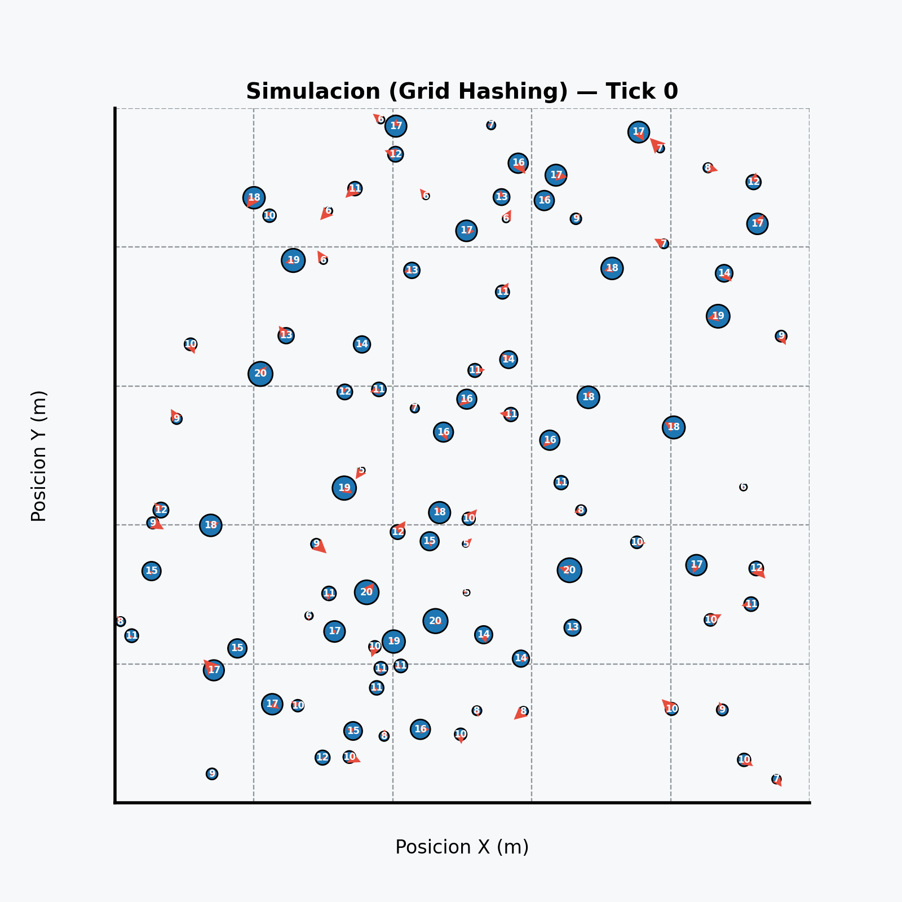

<h1 align="center">
  <strong>IMPACTA</strong>
</h1>

<p align="center">
  Simulador de partículas 2D con física básica
</p>


<p align="center">
  
</p>

El presente proyecto describe el diseño e implementación de un simulador de colisiones de partículas en 2D, estructurado como una plataforma dual para la física computacional y la generación estructurada de datos, idónea para *Machine Learning*.

## 👥 Roles
* **QA, Testing & DevOps:** Tom Jordan Pérez López  
* **Developer 1 (C):** Ricardo Gaspar Reyes Campos
* **Apoyo transversal:** Sandro Giancarlo Sanchez Vicaña
* **Developer 2 (Python):** Raúl Antonio Guzmán López

## 📎 Recursos
* **Diapositivas (Canva):** [Presentación del Proyecto](https://canva.link/zb432bjr0ofj4bi)

https://uni-pe.zoom.us/j/6514273093?pwd=dEVnWEhVUlgzbmRUVTNuNG9YdlpIZz09


## 📂 Estructura del Repositorio

```text
Proy_LP1_2026_1/
├── .gitignore                  # Archivos y carpetas ignorados por Git
├── example.gif                 # Ejemplo de la salida deseada
├── README.md                   # Documentación principal del proyecto
├── docs/                       # Documentación adicional, informes o manuales del proyecto
└── src/                        # Código fuente principal
    ├── c_modules/              # Módulos del simulador en C
    │   ├── Fisica.c            # Lógica de físicas, movimientos y colisiones
    │   ├── Input.c             # Manejo de menús y entrada de datos del usuario
    │   ├── Opti.c              # Archivo principal (Main) y optimización espacial
    │   └── Simulador.h         # Cabecera central (estructuras, prototipos y librerías)
    ├── animador_particulas.py  # Script de Python para renderizar la simulación
    └── makefile                # Script de automatización (compilación, ejecución y renderizado)
