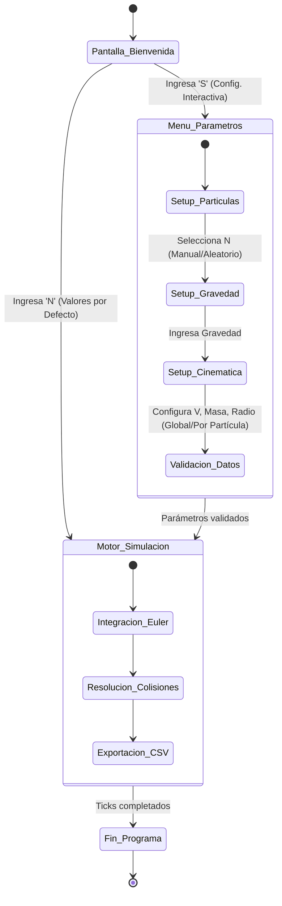

# Diagrama de Estados (Interfaz Interactiva TUI)

## 1. Diagrama



---

## 2. Descripción

El diagrama modela el comportamiento dinámico de la Interfaz Basada en Texto (TUI) de "Impacta" mediante una máquina de estados finitos. La ejecución inicia en una pantalla de bienvenida que bifurca el flujo: una ruta rápida (valores por defecto) y una ruta de configuración interactiva. El superestado `Menu_Parametros` encapsula la lógica secuencial de ingreso de datos (partículas, gravedad y cinemática), garantizando que la información se valide antes de realizar la transición al `Motor_Simulacion`. Una vez en el motor, el sistema entra en un ciclo interno de cálculo físico y exportación de datos, finalizando la ejecución de manera controlada al completar el total de ticks programados.

---

## 3. Observaciones de diseño

- **Separación de fases (Setup vs. Core)**: El diseño aísla completamente la recolección de datos (`Menu_Parametros`) de la ejecución matemática (`Motor_Simulacion`), impidiendo que el motor inicie con datos inconsistentes o nulos.
- **Navegación determinista**: Las transiciones entre estados son lineales y están estrictamente condicionadas por la validación del *input* del usuario por consola (ej. presionar 'S' o 'N'), evitando estados ambiguos.
- **Encapsulamiento lógico**: Agrupar los pasos de configuración dentro de un superestado simplifica la arquitectura y refleja cómo la función de configuración retiene el control del flujo hasta validar todo el bloque de parámetros.
- **Flujo de escape rápido**: Se provee una transición directa desde el inicio hacia el motor de simulación para agilizar las pruebas y mantener el comportamiento histórico del sistema, sin forzar al analista a recorrer el menú interactivo completo.
```
