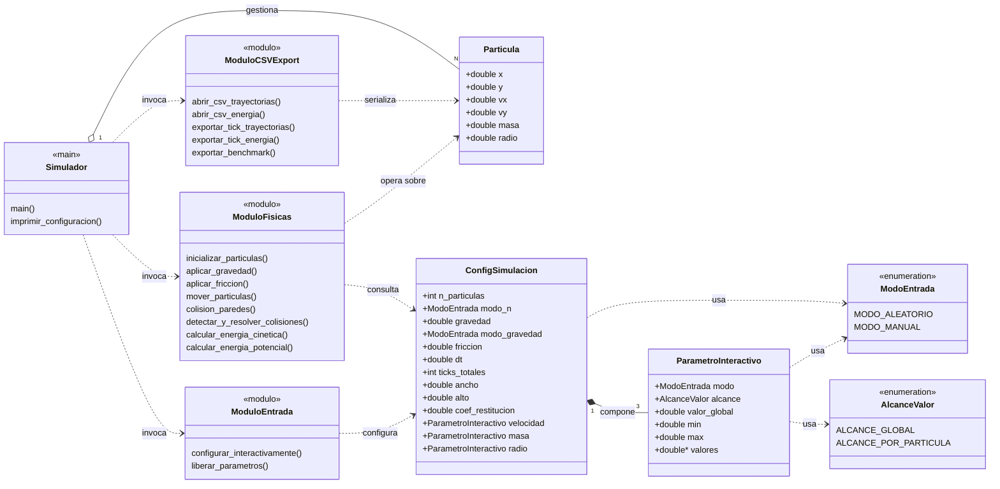

# Avance 02 — Diagrama de Estructuras (UML)

**Rama:** `feature/input-interactivo`
**Curso:** SW-303 Lenguaje de Programación I
**Tipo:** UML de estructuras (estático) — representado como *class diagram* en Mermaid

---

## 1. Diagrama

---

## 2. Descripción

El diagrama representa la organización estática del simulador de N partículas en 2D. Las tres estructuras de datos (`Particula`, `ConfigSimulacion`, `ParametroInteractivo`) y las dos enumeraciones (`ModoEntrada`, `AlcanceValor`) forman el núcleo del modelo; sobre ellas actúan cuatro módulos funcionales implementados en archivos `.c` independientes: `entrada`, `fisicas`, `csv_export` y el `simulador` principal que orquesta el flujo. La composición `ConfigSimulacion *-- ParametroInteractivo` expresa que la configuración contiene tres instancias empotradas (velocidad, masa, radio), mientras que las relaciones de dependencia (`..>`) indican que los módulos consultan o modifican los datos sin poseerlos. La agregación `Simulador o-- Particula` modela la reserva dinámica del arreglo de partículas mediante `calloc`, cuya memoria se libera al finalizar.

---

## 3. Observaciones de diseño

- **Cohesión por módulo**: cada archivo `.c` agrupa funciones con responsabilidad única (entrada interactiva / física / persistencia CSV / orquestación).
- **Acoplamiento bajo**: los módulos se comunican a través de `ConfigSimulacion` y el puntero a `Particula*`, no por variables globales.
- **Enumeraciones tipadas**: `ModoEntrada` y `AlcanceValor` evitan *magic numbers* (0/1) en el código cliente y documentan la intención.
- **Extensibilidad**: agregar un nuevo atributo por partícula (ej. color, carga eléctrica) implica sumar un `ParametroInteractivo` a `ConfigSimulacion` sin tocar los módulos de física o CSV.
