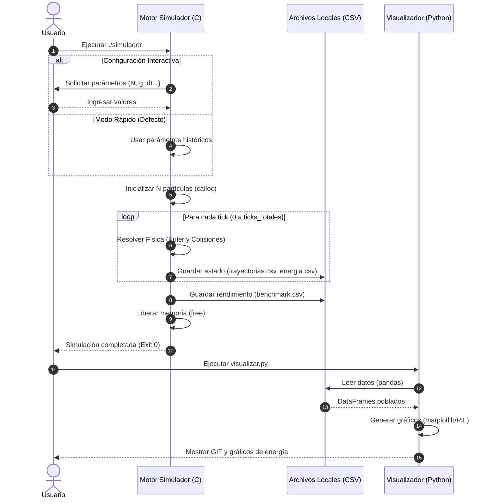

Aquí tienes la reescritura de las descripciones adaptada exactamente a lo que muestra el nuevo diagrama de secuencia, utilizando un lenguaje técnico y directo, ideal para tu repositorio y el informe formal.

```markdown
# Diagrama de Secuencia (UML)

## 1. Diagrama



---

## 2. Descripción

El diagrama ilustra el flujo de ejecución completo (End-to-End) del sistema, abarcando las dos fases principales del proyecto. La secuencia inicia cuando el usuario interactúa con el ejecutable escrito enC, el cual solicita la configuración o adopta parámetros por defecto antes de reservar memoria dinámicamente. El núcleo del proceso es el bucle temporal, donde el motor resuelve el estado físico (integración matemática y colisiones) y lo persiste iterativamente en el sistema de archivos. Tras asegurar la liberación de memoria y concluir la simulación, el control regresa al usuario, quien detona la segunda fase ejecutando el script de Python. Este visualizador consume los datos crudos y devuelve los productos multimedia finales.

---

## 3. Observaciones de diseño

- **Visión End-to-End estructurada**: El flujo demuestra una separación tecnológica clara: un *backend* en C orientado al cálculo numérico de alto rendimiento y un *frontend* analítico en Python dedicado exclusivamente a la renderización.
- **Persistencia como puente de comunicación**: La interacción entre C y Python se realiza de forma asíncrona a través del sistema de archivos locales (CSV). Esto garantiza un acoplamiento nulo entre el motor físico y el visualizador.
