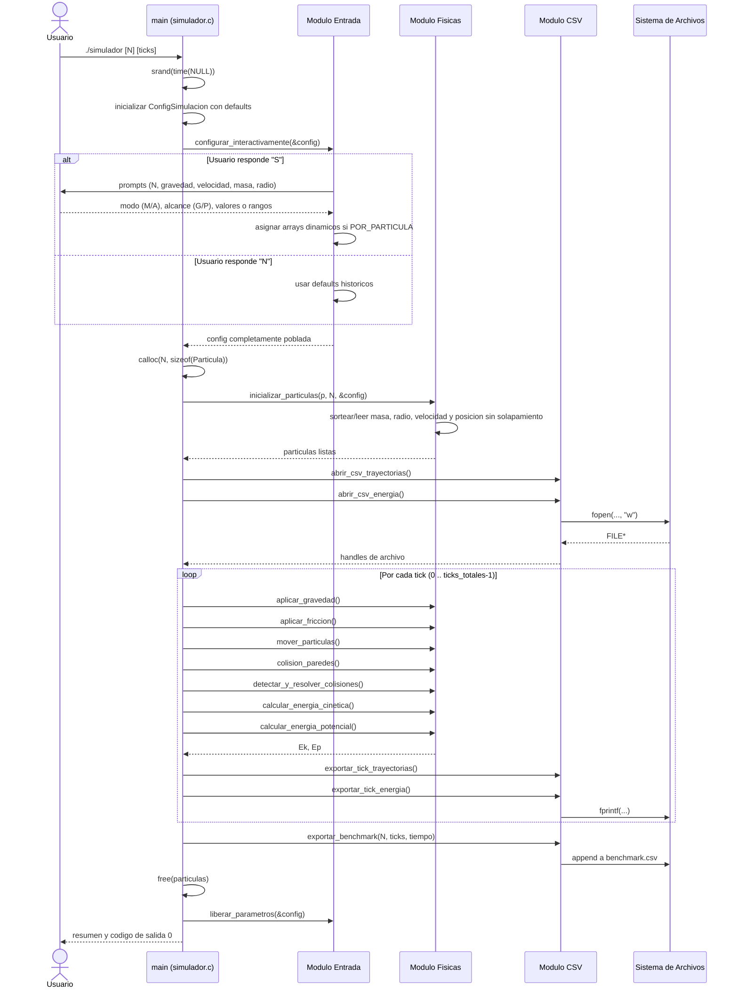

# Avance 03 — Diagrama de Secuencia (UML)

**Rama:** `feature/input-interactivo`
**Curso:** SW-303 Lenguaje de Programación I
**Tipo:** UML de secuencia — representa una ejecución típica del simulador con configuración interactiva.

---

## 1. Diagrama

---

## 2. Descripción

El diagrama muestra el flujo completo de una ejecución del simulador en el eje temporal. La interacción arranca con el `main` recibiendo argumentos del CLI, continúa con el nuevo módulo `Entrada` que dialoga con el usuario para poblar `ConfigSimulacion`, y prosigue con la inicialización de partículas a cargo del módulo `Fisicas`. El núcleo de la ejecución es el bucle de ticks en el cual el orquestador invoca —en el orden justificado en el Entregable 1— gravedad, fricción, movimiento, colisiones con paredes, colisiones entre partículas, cómputo de energías y persistencia en CSV. Al terminar, el `main` libera en orden los recursos: el arreglo de partículas y luego los arreglos internos de `ConfigSimulacion`, garantizando ausencia de *memory leaks*.

---

## 3. Observaciones de diseño

- **Separación de responsabilidades**: `Entrada` nunca accede a archivos CSV ni aplica física; `Fisicas` nunca hace I/O con stdin ni stdout fuera de advertencias.
- **Idempotencia de `liberar_parametros`**: puede llamarse incluso si el usuario saltó el menú, porque los punteros `.valores` se inicializan a `NULL` en `main` antes de cualquier otra operación.
- **Reversión segura ante errores**: las rutas de error (malloc fallido, fopen fallido) imprimen por `stderr` y retornan `EXIT_FAILURE`, sin dejar archivos huérfanos abiertos.
- **Escalabilidad del bucle**: el único punto cuadrático en N es `detectar_y_resolver_colisiones`; el resto es lineal, lo que se confirma en el benchmark del Entregable 1.
