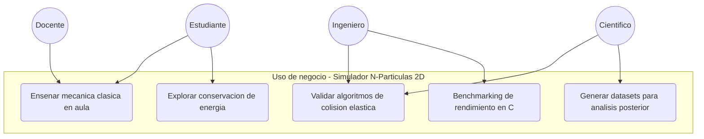
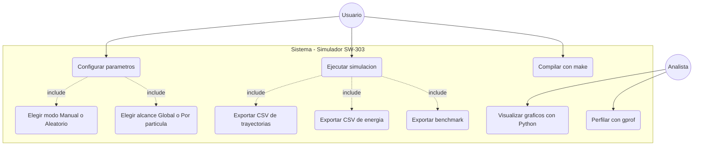

# Diagrama de Casos de Uso (UML)

## 1. Caso de uso de negocio

Este producto de software puede ser utilizado por estudiantes y profesores (incluso, si se escala adecuadamente, ingenieros y cientificos) que necesiten simular la dinámica de N partículas en 2D bajo gravedad, fricción y colisiones elásticas — por ejemplo para docencia de mecánica clásica, prototipos de *granular matter*, o validación de algoritmos de colisión antes de escalarlos a motores 3D.

---

## 2. Caso de uso de sistema

Describe las interacciones concretas entre el usuario y el software compilado. Incluye las relaciones `<<include>>` para los pasos obligatorios que ocurren dentro de "Ejecutar simulación" y "Configurar parámetros".

---

## 3. Escenario principal

**Caso de uso:** Ejecutar simulación con parámetros personalizados.
**Actor principal:** Usuario (ingeniero/estudiante).
**Precondición:** El ejecutable `simulador` ha sido compilado con `make all`.

1. El Usuario ejecuta `./simulador` desde la terminal.
2. El sistema pregunta si desea usar configuración interactiva; el Usuario responde `S`.
3. Para cada parámetro (N, gravedad, velocidad, masa, radio) el sistema pregunta `Manual o Aleatorio`; para velocidad/masa/radio también pregunta `Global o Por partícula`.
4. El Usuario responde según su caso de prueba.
5. El sistema valida rangos y, de ser necesario, vuelve a preguntar hasta obtener entrada válida.
6. El sistema ejecuta el bucle de `ticks_totales` iteraciones aplicando física en orden determinista.
7. Tras cada tick el sistema persiste estado en `trayectorias.csv` y `energia.csv`.
8. Al terminar, el sistema imprime resumen (tiempo total, partículas·tick/s, colisiones por tick), anexa una fila a `benchmark.csv` y libera toda la memoria dinámica.

**Postcondición:** Los tres archivos CSV quedan disponibles en el directorio de trabajo para ser consumidos por `visualizar.py`.

**Flujo alternativo A (saltar menú):** En el paso 2 el Usuario responde `N` y el sistema usa los valores por defecto históricos (N aleatorio, rangos originales de masa/radio/velocidad).

**Flujo de excepción E1:** Si `calloc` o `fopen` fallan, el sistema imprime el error en `stderr`, libera lo asignado y retorna `EXIT_FAILURE` sin archivos huérfanos abiertos.
