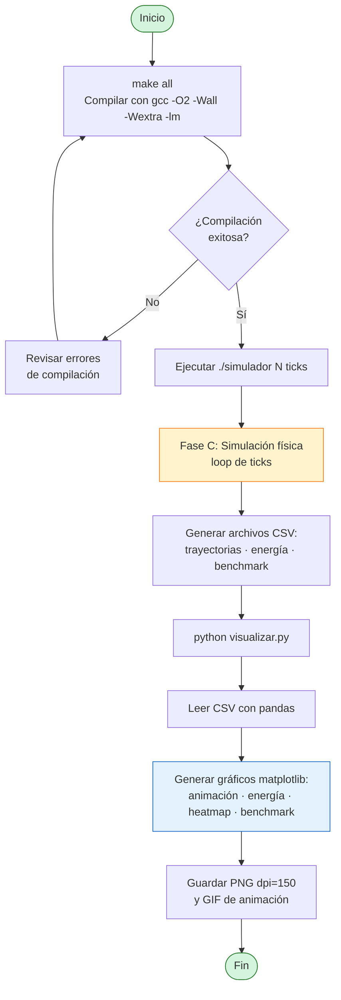
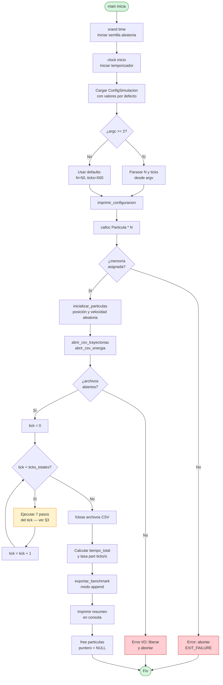
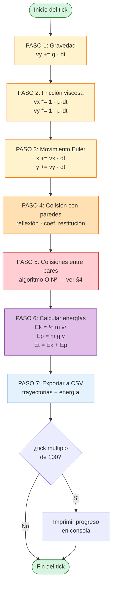
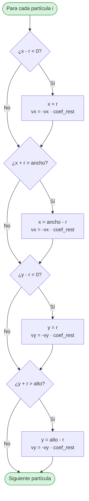
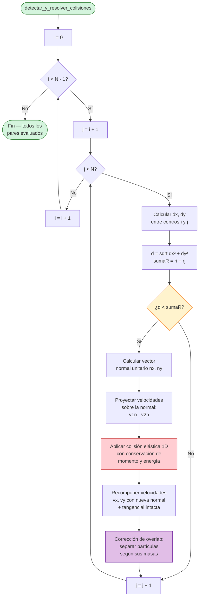
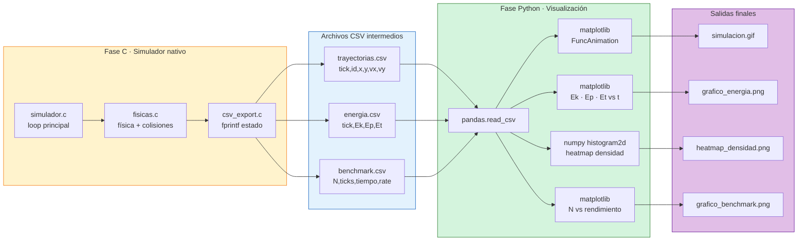
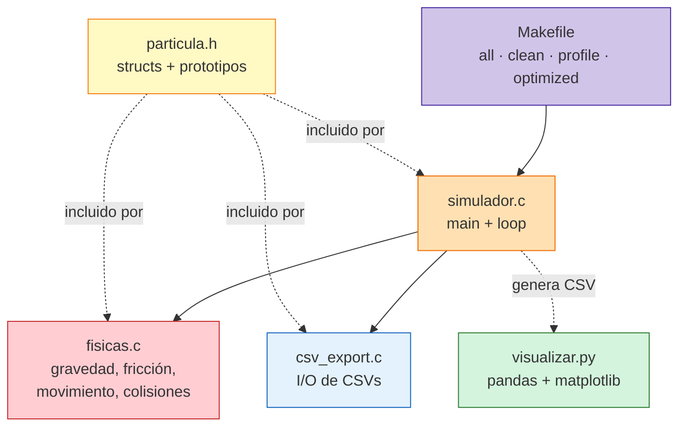

# Flujogramas — Simulador de N Partículas en 2D

**Curso:** SW-303 · Lenguajes de Programación I (Imperativo)
**Proyecto:** Simulador de N partículas con colisiones elásticas, gravedad y fricción
**Stack:** C (C99/C11) · Python/matplotlib · Makefile · gprof
**Autor:** raul · **Fecha:** 2026-04-18

> Los diagramas están escritos en **Mermaid**. Se renderizan automáticamente en GitHub, GitLab, VS Code (extensión *Markdown Preview Mermaid Support*) y en la mayoría de visores modernos de Markdown.

---

## 1. Flujograma global del proceso completo

Vista end-to-end desde la compilación hasta los gráficos finales. Muestra las tres grandes fases del proyecto: **compilación**, **simulación** y **visualización**.

---

## 2. Flujograma del `main()` — Loop principal de simulación

Corresponde al orden de operaciones documentado en `src/simulador.c`. La secuencia por tick está justificada en el Entregable 1: **gravedad → fricción → movimiento → paredes → colisiones → energía → CSV**.

---

## 3. Flujograma de actualización física por tick

Detalle de los **7 pasos** que se ejecutan dentro del `for` principal. Cada paso recorre el arreglo de partículas una vez.

### 3.1 Subflujo — Colisión con paredes (PASO 4)

---

## 4. Flujograma de detección de colisiones O(N²)

Doble bucle anidado sobre todos los pares únicos `(i, j)` con `j > i`. Cuando dos partículas se superponen, se aplica la **respuesta elástica 2D**: descomposición en normal/tangencial, intercambio del componente normal y corrección de overlap.

**Complejidad:** el algoritmo evalúa `N·(N-1)/2` pares por tick → **O(N²)**. Para `N=50` son 1 225 comparaciones/tick; para `N=500` son 124 750 comparaciones/tick.

**Optimización futura sugerida:** *spatial hashing* o *uniform grid* para reducir a **O(N)** amortizado al comparar únicamente partículas en celdas vecinas.

---

## 5. Flujograma del pipeline C → CSV → Python

Flujo de datos entre los dos lenguajes. El simulador en C produce CSVs planos que Python consume con pandas para producir los gráficos.

---

## 6. Resumen visual — Arquitectura de módulos

---

## Leyenda de colores

| Color | Significado |
|-------|-------------|
| Verde | Inicio / fin / salida exitosa |
| Amarillo | Operación física / cálculo |
| Naranja | Condición / interacción con paredes |
| Rojo | Colisión entre partículas / error |
| Morado | Energía / post-procesamiento |
| Azul | I/O · CSV · matplotlib |

---

*Fin del documento de flujogramas.*
